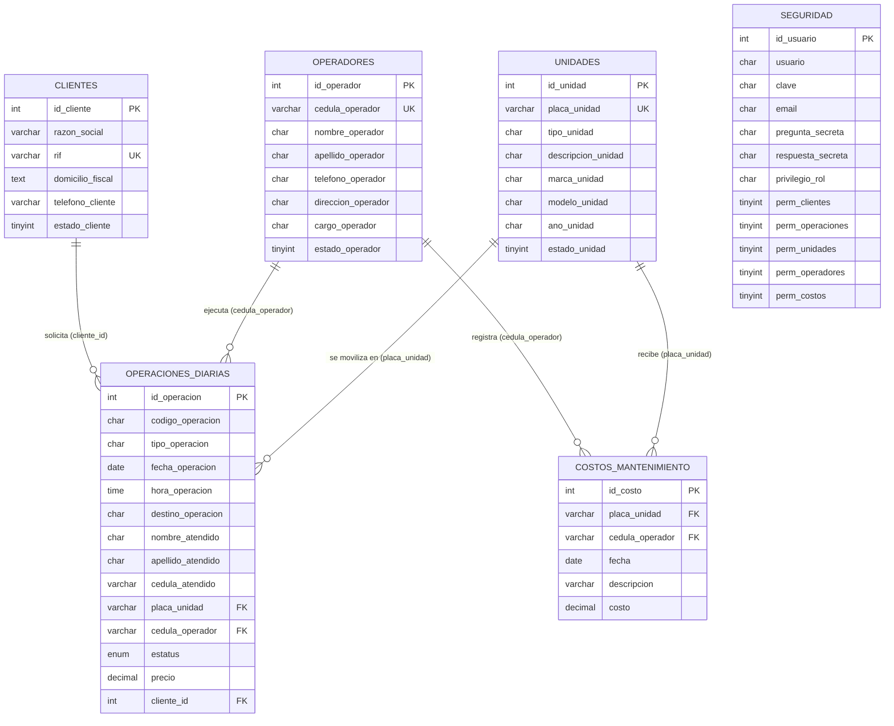
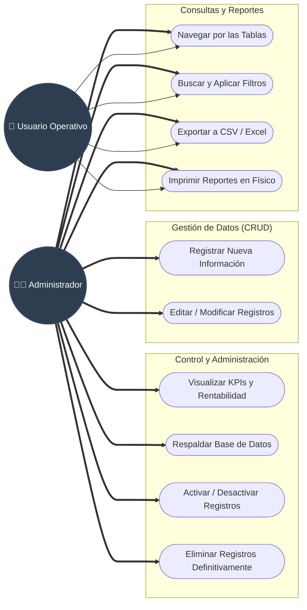

# Diagramas del Sistema (AGRO-SERVICIOS)

Puedes copiar los bloques de código que se encuentran a continuación (lo que está entre los tres acentos graves ````mermaid ````) y pegarlos en [Mermaid Live Editor](https://mermaid.live/) para visualizar, editar y descargar las imágenes para tu presentación.

## 1. Diagrama Entidad-Relación (Base de Datos)



---

## 2. Diagrama de Casos de Uso (Roles y Permisos)


