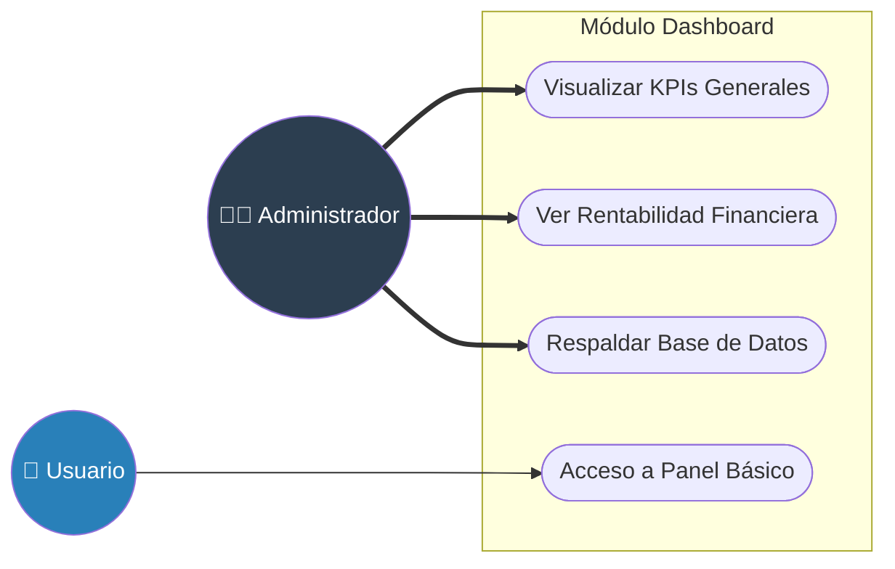
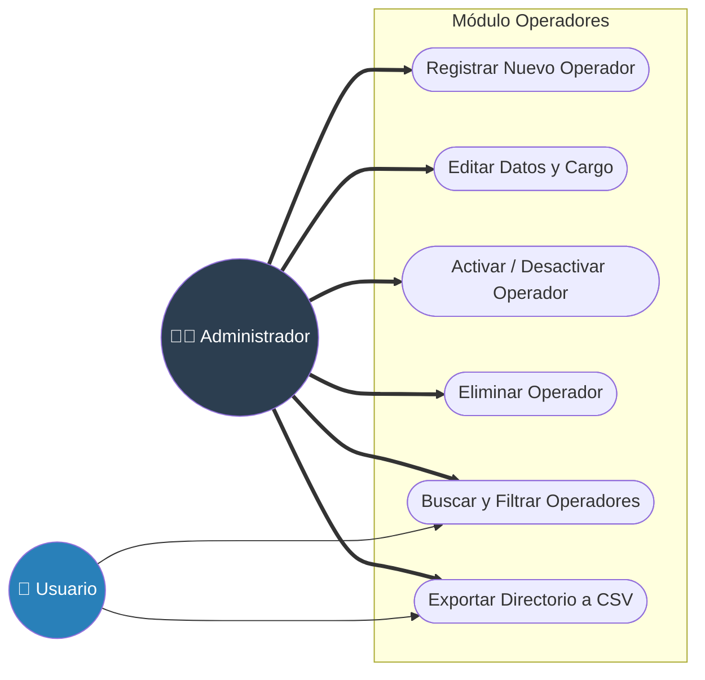
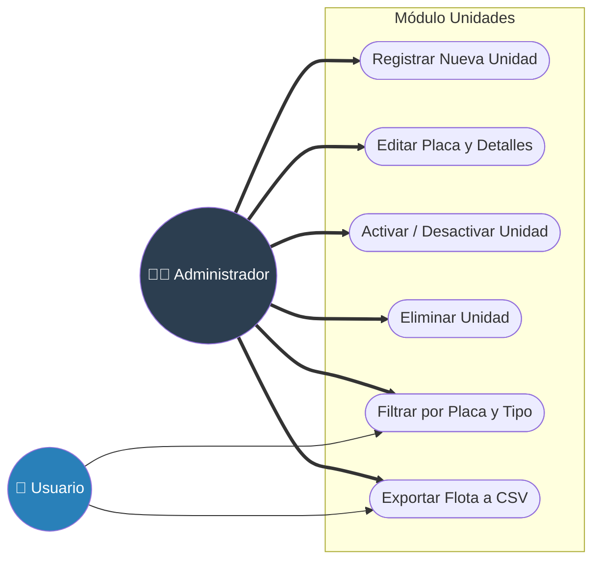
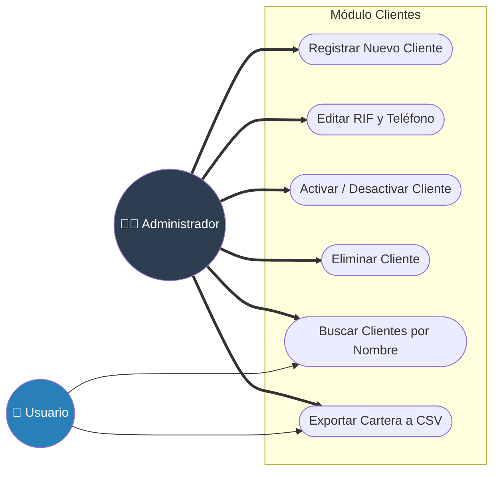
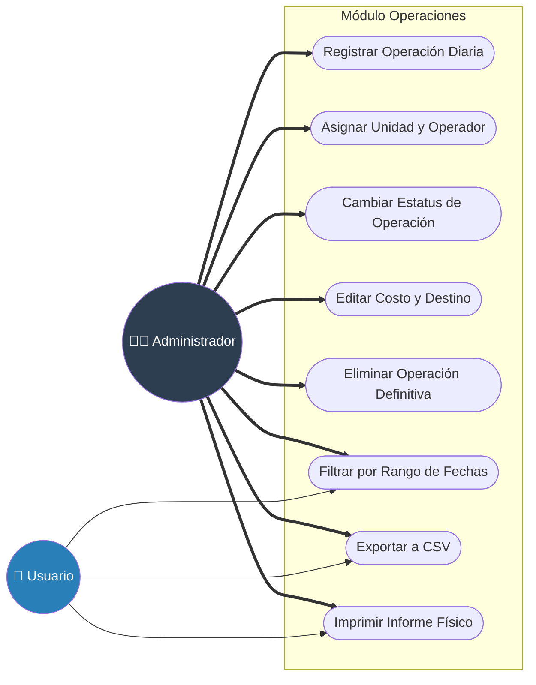

# Casos de Uso por Módulos (Mermaid)

Copia y pega cada bloque en [Mermaid Live Editor](https://mermaid.live/) para generar la gráfica individual de cada módulo de tu sistema.

## 1. Módulo: Dashboard (Inicio)

---

## 2. Módulo: Gestión de Operadores

---

## 3. Módulo: Gestión de Unidades

---

## 4. Módulo: Directorio de Clientes

---

## 5. Módulo: Novedades Diarias (Operaciones)

